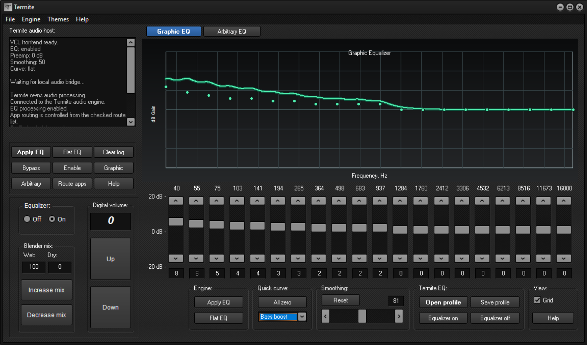
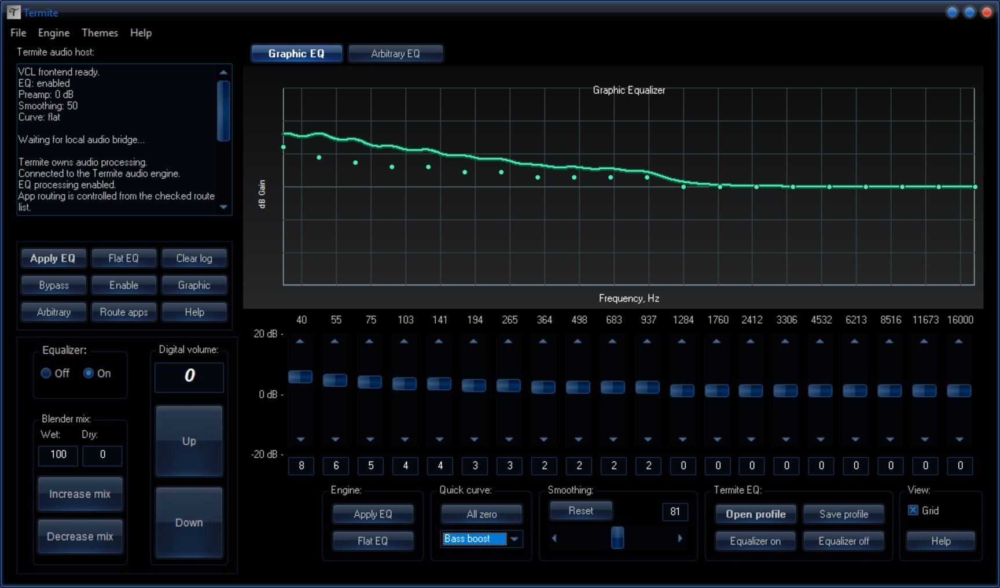
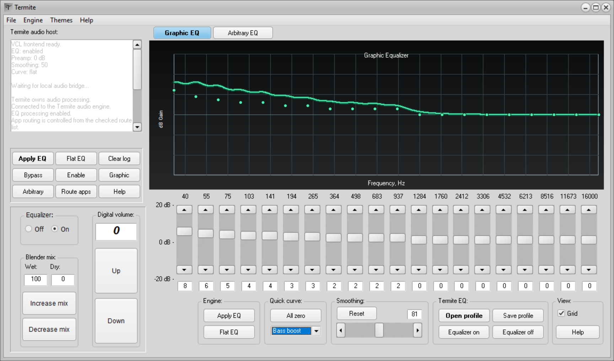
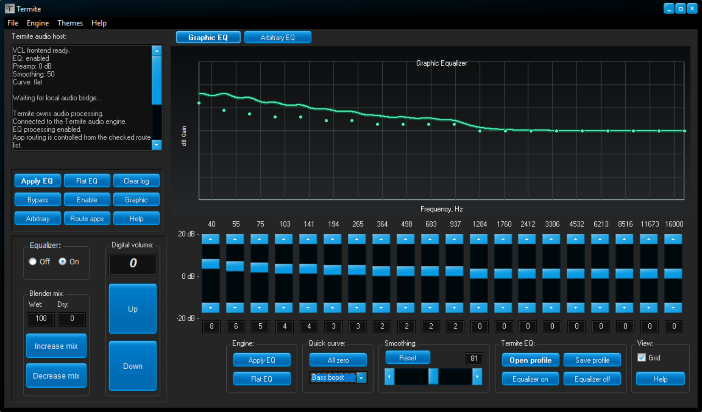
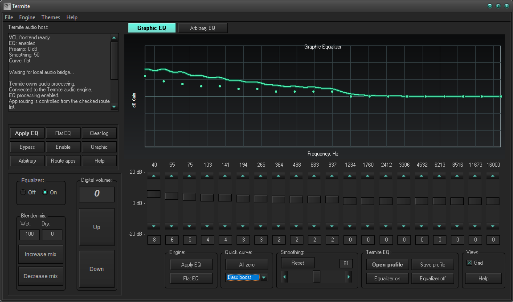

# Termite

Termite is a Windows EQ for selected apps.

## Themes

| Glossy | Cobalt XE Media |
| --- | --- |
|  |  |

| Aqua Light Slate | Aqua Graphite |
| --- | --- |
|  |  |

| Amakrits |
| --- |
|  |

## Using Termite

Start `Termite.exe`, then use **Route apps** to pick the apps you want to process. Real simple!

See [BUILD.md](BUILD.md) for build instructions.

## License

MIT licensed.

:3